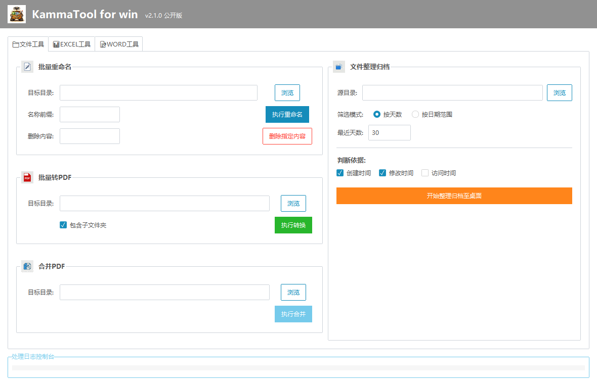

# KammaTool for win

面向 Windows 的桌面办公工具箱，支持文件批处理、Excel 清洗与拆分、Word 文档处理和 PDF 转换。

[下载最新版][latest] · [查看所有版本][releases] · [使用指南](USAGE.md) · [更新记录](CHANGELOG.md)



## 下载与运行

在 [GitHub Releases][releases] 的 **Assets** 中选择与电脑架构对应的便携 ZIP。

| Windows 架构 | 适用设备 | 下载包文件名 |
| --- | --- | --- |
| x64 | Intel 或 AMD 处理器的 64 位 Windows 电脑 | `KammaTool-vX.Y.Z-windows-x64-portable.zip` |
| ARM64 | 搭载 Snapdragon 等 ARM 处理器的 Windows 电脑 | `KammaTool-vX.Y.Z-windows-arm64-portable.zip` |

可在 Windows 的 **设置 → 系统 → 关于 → 系统类型** 查看架构。将 ZIP 完整解压到可写入的文件夹，再双击 `KammaTool.exe`。便携版已包含 Python 运行环境。Office 文件转 PDF、Excel 导出 PDF 和 Word 表格统一需要本机安装对应的 Microsoft Office 桌面应用。

## 功能

| 工具页 | 主要功能 |
| --- | --- |
| 文件工具 | 递归批量重命名、批量转 PDF、PDF 合并、按时间整理归档 |
| EXCEL 工具 | 格式整理、工作表与行列批处理、数据清洗和去重、合并与拆分、模板追加、PDF 和 TXT 导出 |
| WORD 工具 | 统一样式、清除格式、批量替换文本、统一表格、转 TXT、合并文档 |

Excel 工具主要处理 `.xlsx`。旧版 `.xls` 的支持范围随功能而异。部分操作会直接保存到原文件，建议先用副本试跑。完整操作与输出规则见[使用指南](USAGE.md)。

## 从源码运行

请在 Windows 安装 Python 3.13，然后在解压后的项目目录打开 PowerShell。

```powershell
python -m venv .venv
.\.venv\Scripts\python.exe -m pip install -r requirements.txt
.\.venv\Scripts\python.exe main.py
```

依赖安装完成后，也可双击 `run.bat`。程序在本地处理文件，并将最近使用路径和窗口大小等设置保存到 `config.json`。

## 构建与反馈

[构建与发布指南](RELEASING.md)包含 Windows 打包和版本发布步骤。提交问题时，请提供应用版本、Windows 架构、复现步骤和错误信息，并先清理截图及日志中的个人信息。[提交问题][issues]

[latest]: https://github.com/KAMMA415/KammaTool-for-win/releases/latest
[releases]: https://github.com/KAMMA415/KammaTool-for-win/releases
[issues]: https://github.com/KAMMA415/KammaTool-for-win/issues/new
